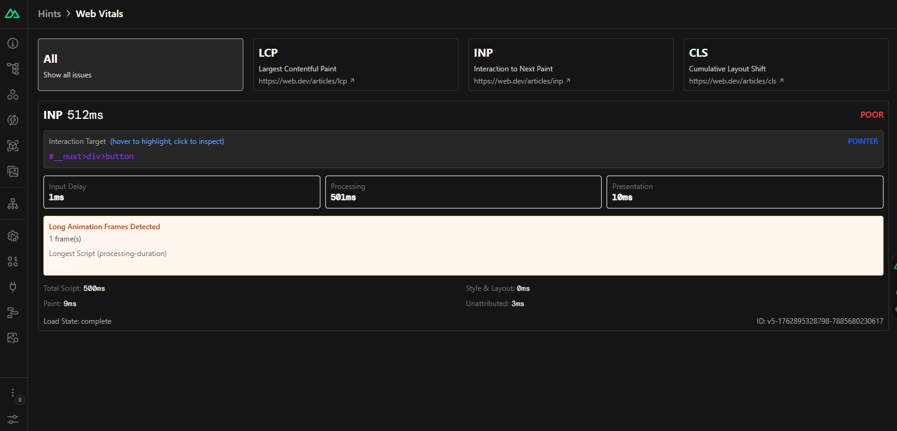

Drill down into Core Web Vitals metrics. See detailed attribution for LCP, INP, and CLS, inspect the problematic elements, and get context-aware advice.



## How it works

Nuxt Hints uses [`web-vitals`](https://github.com/GoogleChrome/web-vitals) to gather Core Web Vitals metrics and automatically logs any metrics that need improvement. It listens for INP, LCP, and CLS and provides detailed attribution for each.

When the LCP element is an image, Nuxt Hints also checks it and warns when it is lazy-loaded or not served in a modern format like `webp` or `avif`.

## Options

```ts [nuxt.config.ts]
export default defineNuxtConfig({
  hints: {
    features: {
      webVitals: {
        options: {
          trackedMetrics: ['LCP', 'CLS'],
          ignoreDomains: ['images.example.com'],
        },
      },
    },
  },
})
```

### `trackedMetrics`

- Type: `Array<'LCP' | 'INP' | 'CLS'>`
- Default: `['LCP', 'INP', 'CLS']`

The metrics to track.

### `ignoreDomains`

- Type: `string[]`
- Default: `[]`

Skip the LCP image checks for images served from these domains and their subdomains.
