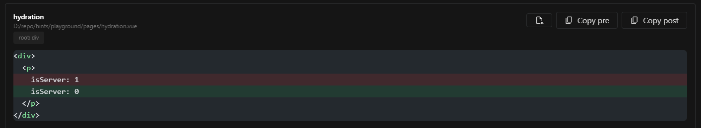

Debug hydration mismatches with a powerful side-by-side diff viewer. See the exact differences between the server-rendered HTML and the client-side result.

## How it works

The module hooks into Vue's hydration process to compare the server-rendered DOM with the client-side DOM. When a mismatch is detected, it captures the pre- and post-hydration HTML for inspection.
