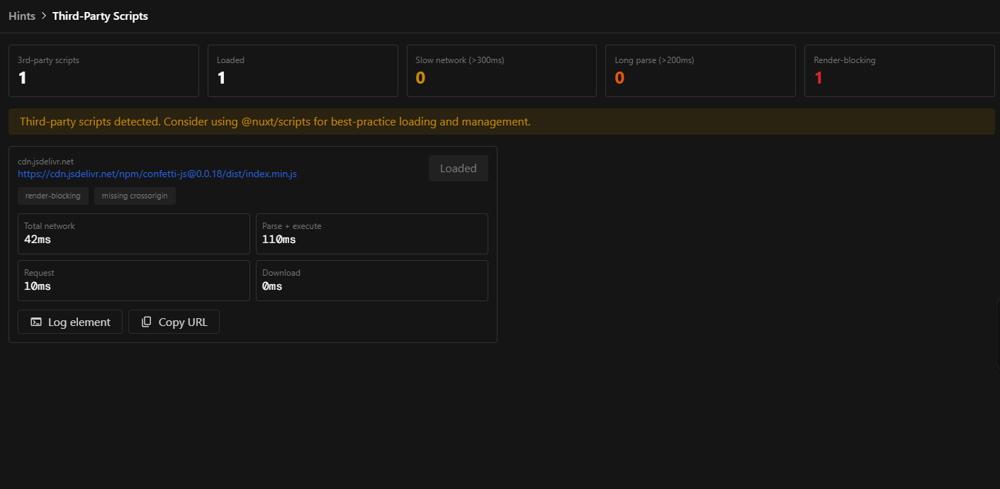

Analyze all third-party scripts on your page. The dashboard shows loading times, render-blocking status, and security attributes, helping you identify and mitigate performance bottlenecks.



## How it works

Using a combination of a Nitro plugin and client-side observers, Nuxt Hints tracks every script loaded on the page, measuring its performance and analyzing its attributes.

Scripts served from your own origin and scripts injected by browser extensions are ignored.

## Options

```ts [nuxt.config.ts]
export default defineNuxtConfig({
  hints: {
    features: {
      thirdPartyScripts: {
        options: {
          ignoredDomains: ['cdn.example.com'],
        },
      },
    },
  },
})
```

### `ignoredDomains`

- Type: `string[]`
- Default: `[]`

Additional domains, and their subdomains, to ignore when detecting third-party scripts.

### `ignoredSchemes`

- Type: `string[]`
- Default: `[]`

Additional URL schemes to ignore. Browser extension schemes (`chrome-extension`, `moz-extension`, `safari-extension` and `ms-browser-extension`) are always ignored.
