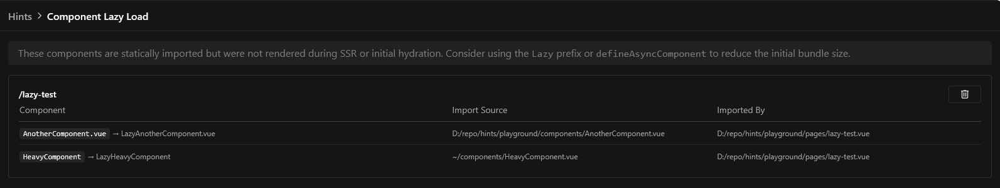

Identify statically imported components that were never rendered during SSR or initial hydration. The module suggests converting them to lazy-loaded components to reduce your users' initial bundle size.



## How it works

At build time, a Vite plugin analyzes your component imports to identify statically imported `.vue` components. At runtime, the module tracks which of those components actually render during SSR and initial hydration. After the page finishes loading, any imported component that was never rendered is flagged as a candidate for lazy loading.

Suggestions are reported to the console and sent to the DevTools UI via Server-Sent Events, where you can review them per route and dismiss entries you've already addressed.

## Fixing a suggestion

Either prefix the component with `Lazy`, or use `defineAsyncComponent`, so it is only downloaded when needed:

```vue
<template>
  <LazyHeavyComponent v-if="show" />
</template>
```

::note{to="/docs/4.x/directory-structure/app/components#dynamic-imports"}
Read more about lazy-loading components in the Nuxt documentation.
::
