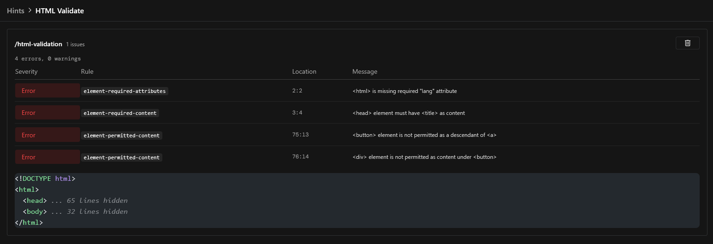

Nuxt Hints includes a built-in HTML validation feature powered by [`html-validate`](https://html-validate.org/). On every server-rendered response, the module intercepts the HTML output and runs it through `html-validate`.



## Options

The `options` are an [`html-validate` configuration](https://html-validate.org/usage/index.html#configuration), merged with the defaults of Nuxt Hints. By default, the `html-validate:standard`, `html-validate:document` and `html-validate:browser` presets are enabled, with a few rules turned off because they conflict with Nuxt defaults.

```ts [nuxt.config.ts]
export default defineNuxtConfig({
  hints: {
    features: {
      htmlValidate: {
        options: {
          rules: {
            'no-redundant-role': 'off',
          },
        },
      },
    },
  },
})
```
