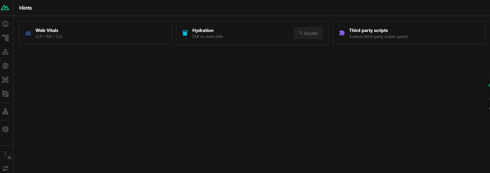

## Introduction

Nuxt Hints integrates directly into the [Nuxt DevTools](/modules/devtools), giving you actionable insights to improve your web vitals, fix hydration mismatches, and audit third-party scripts without ever leaving your development environment.



- **Rich DevTools UI**: a dedicated tab in Nuxt DevTools to visualize issues, inspect elements, and get recommendations.
- **[Web Vitals](/modules/hints/web-vitals)**: real-time metrics for LCP, INP, and CLS with detailed attribution and element-specific optimization tips.
- **[Hydration mismatch debugging](/modules/hints/hydration)**: side-by-side diffing of server-rendered and client-hydrated HTML to pinpoint the exact cause of mismatches.
- **[Third-party script auditing](/modules/hints/third-party-scripts)**: a dashboard to monitor performance, identify render-blocking scripts, and get security recommendations.
- **[Unused component detection](/modules/hints/lazy-load)**: detects statically imported components that aren't rendered during SSR or hydration and suggests lazy-loading them to reduce bundle size.
- **[HTML validation](/modules/hints/html-validate)**: every server-rendered page is checked with [`html-validate`](https://html-validate.org/).

## Automatic Installation

To get started, add `@nuxt/hints` to your project:

```bash
npx nuxt add hints
```

The module is now installed and added to your `nuxt.config.ts`.

## Manual Installation

Or you can install it manually.

::code-group
  ```bash [pnpm]
  pnpm i @nuxt/hints
  ```
  ```bash [yarn]
  yarn add @nuxt/hints
  ```
  ```bash [npm]
  npm i @nuxt/hints
  ```
::

Then, add it to the `modules` in your `nuxt.config`:

```ts [nuxt.config.ts]
export default defineNuxtConfig({
  modules: [
    '@nuxt/hints',
  ],
})
```

::note
Nuxt Hints only runs during development (`nuxt dev`). It adds nothing to your production build.
::

## Usage

Start your Nuxt app, open the Nuxt DevTools and click the **Hints** icon to get started.

The homepage is a central hub to see a summary of all detected issues at a glance. From there, every feature has its own panel:

- **Hover to highlight**: hover over an issue in the DevTools to highlight the corresponding element on your page.
- **Click to inspect**: click to open the component source file directly in your code editor.

## Console Warnings

Nuxt Hints also prints clear, concise messages in your browser console that guide you to best practices and performance improvements:

```
[@nuxt/hints:performance] LCP Element should not have `loading="lazy"`
Learn more: https://web.dev/optimize-lcp/#optimize-the-priority-the-resource-is-given
```

```
[@nuxt/hints] Third-party script "https://cdn.example.com/script.js" is missing crossorigin attribute.
Consider adding crossorigin="anonymous" for better security and error reporting.
```

::tip{to="/modules/hints/configuration"}
If you feel overwhelmed by logs, you can disable some features or only their console output, and fix things step by step.
::
